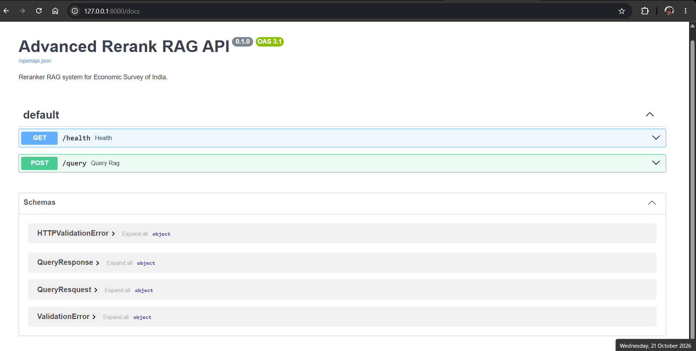
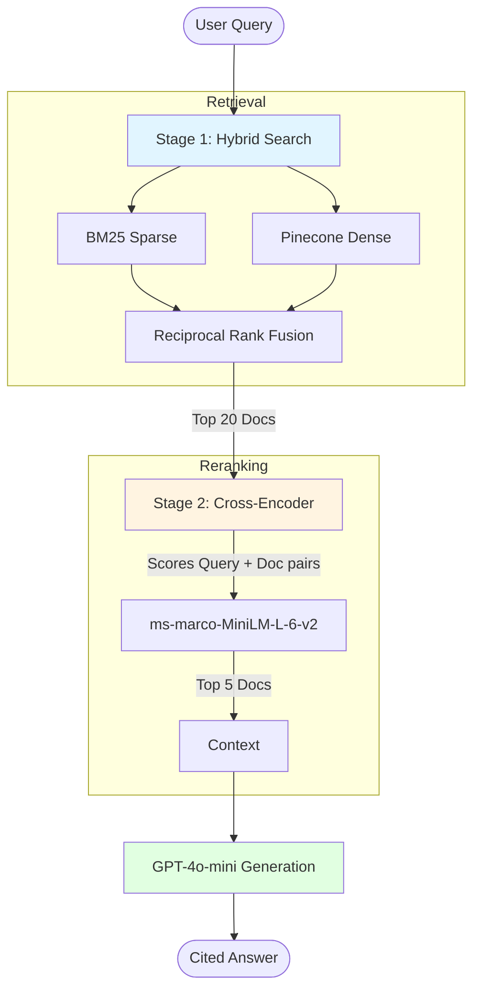

# Advanced Multimodal RAG with Cross-Encoder Reranking

> A production-grade RAG system for the Economic Survey of India. Unlike standard RAG, it extracts and understands **tables, charts, and images** using a Vision LLM, and uses a **Cross-Encoder Reranker** to ensure users get the exact financial data they need.

[](https://www.python.org/downloads/release/python-3120/)
[](https://github.com/langchain-ai/langgraph)
[](https://www.pinecone.io/)
[](https://fastapi.tiangolo.com/)
[](https://streamlit.io/)

---

## The Problem

The Economic Survey of India is a 400+ page document packed with dense text, complex financial tables, and charts. Standard RAG systems fail on this data:
1. **Text extraction destroys tables.** Standard PDF parsers turn tables into unreadable garbage.
2. **Vector search lacks precision.** A standard vector search retrieves "topically similar" chunks, often missing the exact paragraph or table that contains the answer.
3. **UPSC aspirants and economists waste hours** manually searching through chapters to find specific trends (e.g., *"What was the direct tax collection trend for FY26?"*).

## The Solution

This project implements a **2-Stage Advanced RAG Pipeline**:

1. **Multimodal Ingestion:** Renders every PDF page as an image and uses **GPT-4o-mini Vision** to generate highly detailed captions for all charts, tables, and infographics.
2. **Stage 1 (Hybrid Search):** Combines BM25 (keyword) and Pinecone (dense vector) search to fetch the top 20 candidates.
3. **Stage 2 (Cross-Encoder Reranking):** Uses `ms-marco-MiniLM-L-6-v2` to read the query and the top 20 candidates side-by-side, pushing the absolute best 5 chunks to the top.
4. **Generation:** The LLM generates a precise, cited answer based *only* on the reranked context.

---

## Screenshots

### The UI & Final Answer

*The agent extracts precise figures (₹42.70 lakh crore) and cites both the text and the image caption.*

### The "Wow" Factor: Stage 1 vs Stage 2

*Left: Stage 1 Hybrid Search returns messy, topically similar text. Right: Stage 2 Cross-Encoder instantly pushes the correct table (`Score: 5.21`) to the #1 spot.*

### FastAPI Backend


---

## Architecture



---

## Key Engineering Decisions

### 1. Vision Enrichment for Tables
Standard text extraction (PyMuPDF) fails on complex tables. We render each page as a PNG and pass it to GPT-4o-mini with the prompt: *"Transcribe and describe the visual information."* This turns a chart into structured markdown text, which is then embedded into Pinecone.

### 2. Why Cross-Encoder Reranking?
Vector databases (Bi-Encoders) embed the query and document *separately*, which is fast but loses nuance. A **Cross-Encoder** passes the query and document *together* through the transformer, allowing it to understand the exact relationship between them. 
*   **Trade-off:** Cross-Encoders are slower (~1.5 seconds for 20 docs) and cannot be pre-computed. But by using them only on the top 20 candidates from Stage 1, we get 100% of the accuracy with a negligible latency cost.

### 3. Caching the Vision API
Processing 163 pages with GPT-4o-mini Vision takes time and money. The ingestion script caches the enriched documents to `data/enriched_cache.json`. If the script crashes, subsequent runs instantly load the cache and skip the OpenAI API calls.

---

## Freelancing Application: Coaching Institutes & EdTech

This architecture is the exact blueprint needed for **UPSC, State PSC, and Banking exam coaching institutes**.

Coaching centers have massive libraries of PDFs (Economic Surveys, Gazetteers, Current Affairs magazines). Students struggle to find specific data points. By deploying this system:
*   **Students** can ask natural language questions and get exact, cited answers from charts and tables.
*   **Institutes** can offer a premium "AI Study Assistant" as a subscription feature.
*   **The same pipeline** can be instantly adapted for corporate annual reports, legal contracts, or medical journals.

---

## Tech Stack

| Layer | Tech |
|-------|------|
| **Orchestration** | LangGraph (`StateGraph`) |
| **LLM** | OpenAI GPT-4o-mini |
| **Embeddings** | OpenAI `text-embedding-3-small` |
| **Vector DB** | Pinecone (Serverless) |
| **Sparse Search** | `rank_bm25` |
| **Reranker** | `sentence-transformers` (Cross-Encoder) |
| **PDF Parsing** | PyMuPDF (`fitz`) |
| **Backend** | FastAPI + Uvicorn |
| **Frontend** | Streamlit |
| **Deployment** | Docker + Docker Compose |

---

## Quickstart

### Run with Docker (Recommended)

```bash
git clone https://github.com/jaskaranjjk97/Advanced-Rerank-RAG.git
cd Advanced-Rerank-RAG
cp .env.example .env
# Add your OPENAI_API_KEY and PINECONE_API_KEY

# 1. Create Pinecone Index (Run once)
docker compose run api python -m app.pinecone_setup

# 2. Ingest PDFs (Run once - takes 5-10 mins)
docker compose run api python -m scripts.ingest

# 3. Start the App
docker compose up --build
```
Open **http://localhost:8501**.

### Run Locally

```bash
python -m venv .venv
source .venv/bin/activate  # Windows: .venv\Scripts\activate
pip install -r requirements.txt
cp .env.example .env

# One-time setup
python -m app.pinecone_setup
python -m scripts.ingest

# Start Backend
uvicorn app.main:app --port 8000

# Start Frontend (In a new terminal)
streamlit run ui/streamlit_app.py
```

## Environment Variables

```env
OPENAI_API_KEY=sk-...
OPENAI_MODEL=gpt-4o-mini
PINECONE_API_KEY=pc-...
PINECONE_INDEX_NAME=advanced-rerank-rag
PINECONE_REGION=us-east-1
PINECONE_CLOUD=aws
```

---

## Project Structure

```text
advanced-rerank-rag/
├── app/
│   ├── config.py                # Env vars
│   ├── state.py                 # RAGState TypedDict
│   ├── llm.py                   # ChatOpenAI factory
│   ├── parsers.py               # PyMuPDF text/image extraction
│   ├── enrichment.py            # Vision LLM caption generation
│   ├── chunking.py              # Text splitter logic
│   ├── retrieval.py             # Stage 1: Hybrid BM25 + Pinecone
│   ├── reranker.py              # Stage 2: Cross-Encoder
│   ├── graph.py                 # LangGraph pipeline
│   └── main.py                  # FastAPI backend
├── data/
│   ├── pdfs/                    # Economic Survey PDFs
│   ├── extracted_images/        # Page renders
│   └── enriched_cache.json      # Vision API cache
├── scripts/
│   ├── ingest.py                # Data ingestion pipeline
│   └── run_graph.py             # CLI test
├── ui/
│   └── streamlit_app.py         # Stage 1 vs 2 UI
├── tests/
│   ├── test_pipeline.py         # Retrieval + Reranking test
│   └── test_reranker.py         # Reranker unit test
├── Dockerfile
├── Dockerfile.ui
├── docker-compose.yml
└── requirements.txt
```

## Testing and Code Quality

Run Ruff to check the code:

```bash
ruff check .
```

Format the code:

```bash
ruff format .
```

Run the check again:

```bash
ruff check .
```

---

## Limitations & Production Roadmap

While this project is highly capable, it is currently optimized as a portfolio demonstration. Here is an honest assessment of its limitations and how I would architect it for enterprise production.

### 1. Vision API Latency & Cost
**Limitation:** Processing 163 pages with GPT-4o-mini Vision takes about 5-10 minutes and costs ~$0.20 per ingestion cycle. 
**Production Improvement:** 
- Implement a **queue-based pipeline** (e.g., Celery + Redis) to process PDFs asynchronously in the background.
- Use a local Vision model (like `llava` or `florence-2`) to eliminate API costs for the initial parsing phase, or use OpenAI's Batch API for a 50% cost reduction.

### 2. Cross-Encoder Latency
**Limitation:** The cross-encoder (`ms-marco-MiniLM-L-6-v2`) adds ~1.5 seconds of latency per query because it must process the query and 20 documents simultaneously.
**Production Improvement:**
- Export the model to **ONNX runtime** or **TensorRT** for a 3x speedup.
- Implement **caching** (e.g., Redis) for frequent queries so the reranker only runs on new questions.
- If scaling to millions of users, swap the local model for a managed API like **Cohere Rerank**, which is highly optimized for low-latency inference.

### 3. In-Memory BM25 Index
**Limitation:** The BM25 sparse index is built in memory on server startup. For 721 chunks, this takes ~2 seconds. For 100,000 chunks, it would consume too much RAM.
**Production Improvement:**
- Move BM25 to a dedicated search engine like **Elasticsearch** or **OpenSearch**.
- Use **Pinecone's native sparse-dense hybrid index** or **Qdrant's sparse vectors** to handle both dense and sparse retrieval inside the vector database, eliminating the need for an in-memory BM25 index entirely.

### 4. Static Ingestion
**Limitation:** Currently, documents must be ingested via a CLI script (`scripts/ingest.py`).
**Production Improvement:**
- Build an **Admin Dashboard** in Streamlit where clients can drag-and-drop new PDFs, track ingestion progress, and see the parsed Vision captions before they are pushed to the vector database.
- Add a `doc_id` and `version` metadata field so documents can be updated or deleted without wiping the entire Pinecone index.

### 5. Lack of Evaluation Benchmark
**Limitation:** The accuracy improvement of the Cross-Encoder is visually proven, but not statistically measured.
**Production Improvement:**
- Integrate **RAGAS** (as demonstrated in my CRAG project) to evaluate `context_precision` and `faithfulness`. 
- Create a gold-standard dataset of 50 questions and establish a baseline metric to prove the exact percentage uplift the Cross-Encoder provides over standard vector search.

---

## Freelance Scaling: How I'd build this for your Institute

If I were deploying this for a UPSC or banking coaching institute, here is how I would adapt the architecture to fit their exact business needs:

1. **Multi-Tenant Architecture:** Allow students to query across *multiple* books (Economic Survey, India Year Book, Current Affairs Magazines). We would tag chunks with `subject_id` so students can filter queries (e.g., "Search only in Economy books").
2. **Citation Highlighting:** Instead of just returning the text, the UI would return a cropped image of the exact chart or table from the PDF, highlighting the specific row the LLM used to generate the answer.
3. **Voice-to-Text Search:** Integrate Whisper API so students can ask questions using their voice, which is a highly requested feature in mobile-first EdTech apps.
4. **Cost-Optimized Vision:** Implement a routing layer where only pages with charts or tables are sent to the Vision model. Pure text pages skip the Vision API entirely, reducing processing costs by 60%.